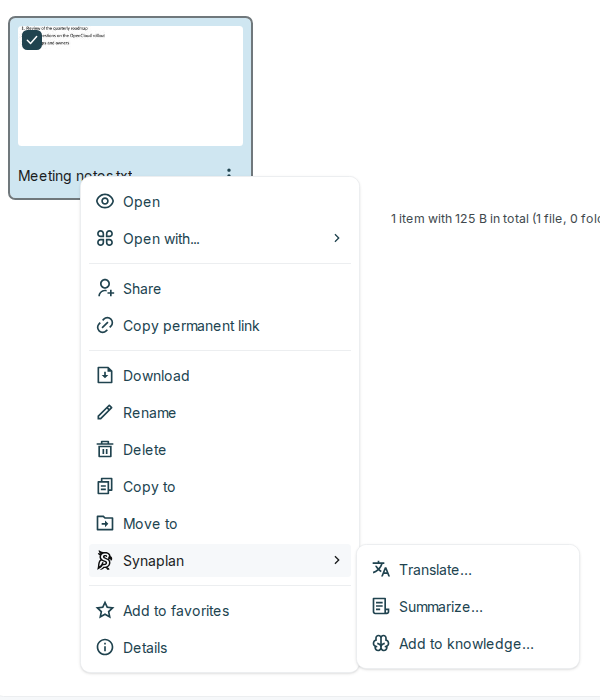

# Synaplan OpenCloud Integration

> **Early development — not ready for production use.**

📖 **[Service reference docs](https://metadist.github.io/synaplan-opencloud/)** — env vars, example config, and deprecations, regenerated from the `main` branch on every push.

OpenCloud web extension that integrates [Synaplan](https://github.com/metadist/synaplan) AI features into OpenCloud. When both sides share a login provider, each person's OpenCloud login is exchanged for their own Synaplan account with [RFC 8693 token exchange](https://datatracker.ietf.org/doc/html/rfc8693). A shared API key is also supported; in that mode every person uses the same Synaplan account.

From a file you can summarize, translate, and add it to the Synaplan knowledge base (including update and remove when the file is already there). A summary or translation can be saved into your personal space under `Synaplan/Documents`. Files sent to Synaplan are labelled as coming from OpenCloud.

A file Synaplan can search carries the Synaplan bird in the file list, with its state (searchable, being made searchable, changed since, failed) as the label. The bird needs Synaplan's cloud file state (`CLOUD_FILES_ENABLED` on Synaplan); without it the file list shows no bird. The Synaplan tab in the file sidebar names that same state and the knowledge folder, and removes the file from it. The tab is shown for a file only, and only when Synaplan reports that cloud file state is on.



**Requires OpenCloud 8.1.0 or later.**

**Synaplan and OpenCloud must be behind the same OIDC identity provider (Keycloak).** Token exchange only works when both services trust the same Keycloak realm. There is currently no support for separate identity providers.

> **Dev stack requires the [Synaplan dev stack](https://github.com/metadist/synaplan) running with `docker compose --profile oidc up -d`.**
>
> On Linux, add `127.0.0.1 host.docker.internal` to `/etc/hosts` (macOS/Windows: works out of the box).

## Quick Start

```bash
# 1. Start the Synaplan dev stack (in the synaplan repo)
cd ../synaplan && docker compose --profile oidc up -d

# 2. Build and start
make frontend-install && make frontend-build && make docker-up

# 3. Visit https://host.docker.internal:9200
#    Login with: admin / admin, demo / demo or testuser / testpass123
```

## Configuration

The frontend extension and the Go backend are configured separately.

**Frontend** — set the Synaplan instance URL via OpenCloud's [`apps.yaml`](dev/docker/opencloud.apps.yaml):

```yaml
synaplan:
  config:
    synaplanUrl: 'https://synaplan.example.com'
```

The app menu tile opens this URL in a new tab when set.

**Backend** — env vars (full list with descriptions in [`backend/pkg/config/config.go`](backend/pkg/config/config.go)).

The backend authenticates outbound calls to Synaplan in one of two modes. Pick one.

### Mode A: per-user OIDC token exchange (recommended)

Each call to Synaplan rides on the logged-in OpenCloud user's identity, exchanged via Keycloak's RFC 8693 token-exchange grant. Synaplan sees the real user; per-user audit, quotas and rate limits work as expected. Requires Synaplan and OpenCloud to share the same Keycloak realm.

| Var | Purpose |
|-----|---------|
| `SYNAPLAN_URL` | Base URL of the Synaplan instance the backend talks to. |
| `OC_OIDC_ISSUER` | Issuer of the Keycloak realm OpenCloud and Synaplan share (usually already set for OpenCloud). The authorization, token and revocation endpoints are read from its discovery document unless set below. |
| `SYNAPLAN_OIDC_AUTHORIZATION_ENDPOINT` / `SYNAPLAN_OIDC_TOKEN_ENDPOINT` / `SYNAPLAN_OIDC_REVOCATION_ENDPOINT` | Optional. Set an endpoint instead of the published one: for a provider without discovery (then set all three, no issuer needed), or one the backend reaches by an internal address. |
| `SYNAPLAN_OIDC_EXCHANGE_CLIENT_ID` / `SYNAPLAN_OIDC_EXCHANGE_CLIENT_SECRET` | Confidential client credentials that perform the exchange. |
| `SYNAPLAN_OIDC_TARGET_AUDIENCE` | Audience (Synaplan client ID) baked into the exchanged token. |

#### Working while a person is away

A person can allow Synaplan to work for them while they are not using OpenCloud. On the Synaplan page, *Allow* runs an authorization code flow with PKCE and `offline_access` for the exchange client, silently in a hidden frame when the person is signed in at Keycloak; when Keycloak needs the person (a login, a consent), *Sign in to allow* opens it in a popup. Keycloak returns to `callback.html`, a static page that ships with the extension, which hands the answer back to the Synaplan page; the page accepts it only from its own frame or popup and with the state it sent. The backend redeems the code for an offline token, checks it belongs to the signed-in person (as Keycloak's token exchange names them, never as the bearer alone claims), and keeps it; *Stop* revokes it at Keycloak. While the person is away, each call to Synaplan carries a token exchanged from that offline token, so Synaplan still sees the person and nothing more.

The offline tokens are kept in OpenCloud's NATS JetStream key-value store, one key per person, so a restart or another replica of this service still has them. A write replaces a token only when that key's revision is still the one that was read, and a person's token is refreshed on one replica at a time, under a lease in the same bucket that NATS expires on its own if a replica dies (NATS 2.11 or later; OpenCloud's built-in NATS is newer). Every token is encrypted before it reaches the store (AES-256-GCM, a data key per value wrapped by a key derived from `SYNAPLAN_STORE_ENCRYPTION_SECRET`, both bound to the person), so NATS and its backups hold nothing usable on their own. A token that does not decrypt, for example after its secret was dropped, counts as not allowed until the person allows again, which replaces it; it is never deleted for that alone, so a replica that does not know a new secret yet loses nobody while a rotation rolls out. A key that cannot be reached is an outage and changes nothing. To rotate, set the new secret as `SYNAPLAN_STORE_ENCRYPTION_SECRET` and the old one in `SYNAPLAN_STORE_ENCRYPTION_PREVIOUS_SECRETS`; tokens move to the new secret when they are next used, and the old one can be removed once they all have. Like OpenCloud's own services, the backend starts while NATS is not reachable yet; until it is, the Synaplan page, allowing and working while away answer that the store is unavailable.

| Var | Purpose |
|-----|---------|
| `SYNAPLAN_STORE` / `OC_PERSISTENT_STORE` | `nats-js-kv` (default) or `memory`. `memory` keeps the tokens in this process: a restart forgets them and other replicas never see them; the backend warns at start. Other values OpenCloud accepts in `OC_PERSISTENT_STORE`, such as `redis-sentinel`, stop the backend; set `SYNAPLAN_STORE` then. |
| `SYNAPLAN_STORE_NODES` / `OC_PERSISTENT_STORE_NODES` | Addresses of OpenCloud's NATS, `host:port`, comma-separated. Default `127.0.0.1:9233`. OpenCloud's NATS listens on localhost unless `NATS_NATS_HOST` is set. |
| `SYNAPLAN_STORE_DATABASE` | Key-value bucket for the tokens. Default `synaplan-delegation`. |
| `SYNAPLAN_STORE_REPLICAS` | Copies of the bucket in a NATS cluster. Default `1`. The bucket's settings are applied at every start. |
| `SYNAPLAN_STORE_AUTH_USERNAME` / `SYNAPLAN_STORE_AUTH_PASSWORD` (`OC_PERSISTENT_STORE_AUTH_*`) | Credentials for NATS, when it requires them. |
| `SYNAPLAN_STORE_ENABLE_TLS` / `SYNAPLAN_STORE_TLS_INSECURE` / `SYNAPLAN_STORE_TLS_ROOT_CA_CERTIFICATE` (`OC_PERSISTENT_STORE_*`, `OC_INSECURE`) | TLS to NATS. Insecure skips verification and is ignored when a root CA is set. |
| `SYNAPLAN_STORE_ENCRYPTION_SECRET` | Secret the key that encrypts the tokens is derived from. Set it: without it the exchange client secret is used, and changing that secret makes everyone allow again. |
| `SYNAPLAN_STORE_ENCRYPTION_PREVIOUS_SECRETS` | Earlier encryption secrets, comma-separated, still read after a rotation. A token moves to the current secret the next time it is used. |

The development compose sets the address to `opencloud:9233` and `NATS_NATS_HOST=0.0.0.0` so this service can reach NATS on the compose network; the port is not published on the host.

This needs, on the exchange client in Keycloak: the standard flow with PKCE (S256), a redirect URI covering where the extension is served from (the callback is built into its assets with a content hash, so `<that URL>/*`; with OpenCloud serving it, `<OpenCloud URL>/*`), and the `offline_access` scope. OpenCloud's content security policy must let its pages frame that callback and Keycloak: `frame-ancestors 'self'` and Keycloak's origin in `frame-src` (see `dev/docker/opencloud.csp.config.yaml`). The development server of the extension always runs on port 9210 (`strictPort`), so the realm can allow it.

#### Notifications from Synaplan

Synaplan tells this OpenCloud about changes by calling `POST /api/synaplan/inbound` with a signed JWT (EdDSA, type `synaplan-notification+jwt`). Synaplan must be configured for this OpenCloud (`PLATFORM_LINKS_OIDC_CLOUD_*` on Synaplan) and reach the backend at that route, usually directly rather than through OpenCloud's proxy. The backend reads Synaplan's issuer and keys from `/.well-known/synaplan-configuration` and `/.well-known/jwks.json` at `SYNAPLAN_URL`, never from a URL inside a token, and accepts a notification only for this instance, within its time window and once. `identity_revoked` (the person ended their link in Synaplan) names the person by their Keycloak subject and revokes their offline token here.

### Mode B: shared API key (simple, discouraged)

For single-tenant deployments where Synaplan and OpenCloud don't share an identity provider, the backend can attach a single static Synaplan API key to every outbound call instead of doing token exchange. Generate one in Synaplan's API-Keys settings, then set:

| Var | Purpose |
|-----|---------|
| `SYNAPLAN_URL` | Base URL of the Synaplan instance. |
| `SYNAPLAN_API_KEY` | Synaplan API key (`sk_…`). Sent as `X-API-Key` on every outbound call. |

**Caveat:** in this mode every call to Synaplan looks like the same user. There is no per-user identity, no per-OC-user audit trail, no per-user quotas, and you cannot revoke access for an individual OpenCloud user without revoking the key for everyone. Prefer Mode A unless you understand and accept these tradeoffs.

When `SYNAPLAN_API_KEY` is set it takes precedence and the `SYNAPLAN_OIDC_*` variables are ignored.

### Shared

| Var | Purpose |
|-----|---------|
| `OC_REVA_GATEWAY` | CS3 gateway used by the backend to read user files. |
| `OC_JWT_SECRET` | Shared JWT secret with OpenCloud's reva proxy. |

The backend downloads file contents from OpenCloud's storage data server, so that server must be reachable from the backend. On the OpenCloud side set `STORAGE_USERS_HTTP_ADDR` to a non-loopback address and `STORAGE_USERS_DATA_SERVER_URL` to a URL the backend can resolve (for example `http://opencloud:9158/data`).

The dev defaults live in [`docker-compose.yml`](docker-compose.yml) and use Mode A.

## Development

```bash
# Frontend
make frontend-install       # Install dependencies
make frontend-serve         # Vite dev server on :9201 (with HMR, auto-registers in OpenCloud)
make frontend-build         # Production build (CI and the Docker image)
make frontend-build-dev     # Development build for the bundled flow on :9200 (no OpenCloud restart needed)
make frontend-lint          # ESLint
make frontend-format        # Prettier (write)
make frontend-format-check  # Prettier (check)
make frontend-typecheck     # TypeScript type check
make frontend-test-unit     # Vitest unit tests
make frontend-test-e2e      # Playwright E2E tests (against :9200)
make frontend-test-e2e-dev  # Playwright E2E tests (against vite dev server :9201)

# Backend
make backend-build         # Build Go binary
make backend-dev           # Air hot-reload
make backend-test          # Go tests
make backend-lint          # golangci-lint
make backend-format        # gofmt

# All
make format                # Format frontend + backend

# Docker
make docker-up             # Start OpenCloud + backend
make docker-down           # Stop

# Docs (service reference site — env vars, example config, deprecations)
make docs                  # Build Docusaurus site into docs/generated/ (gitignored)
make docs-serve-prod       # Serve the built site at http://localhost:3000
make docs-clean            # Wipe .cache/ + docs/generated/
```

## License

Apache-2.0
